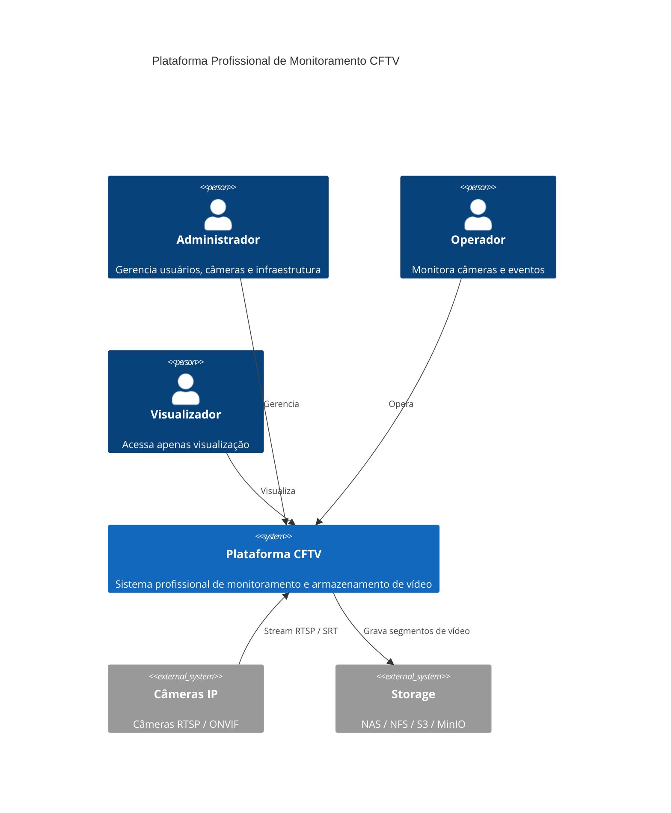
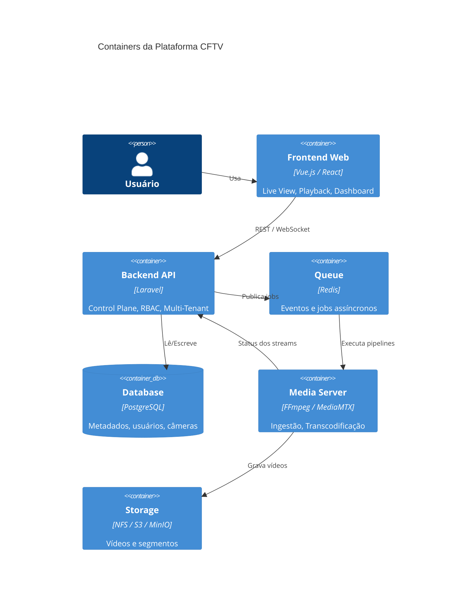
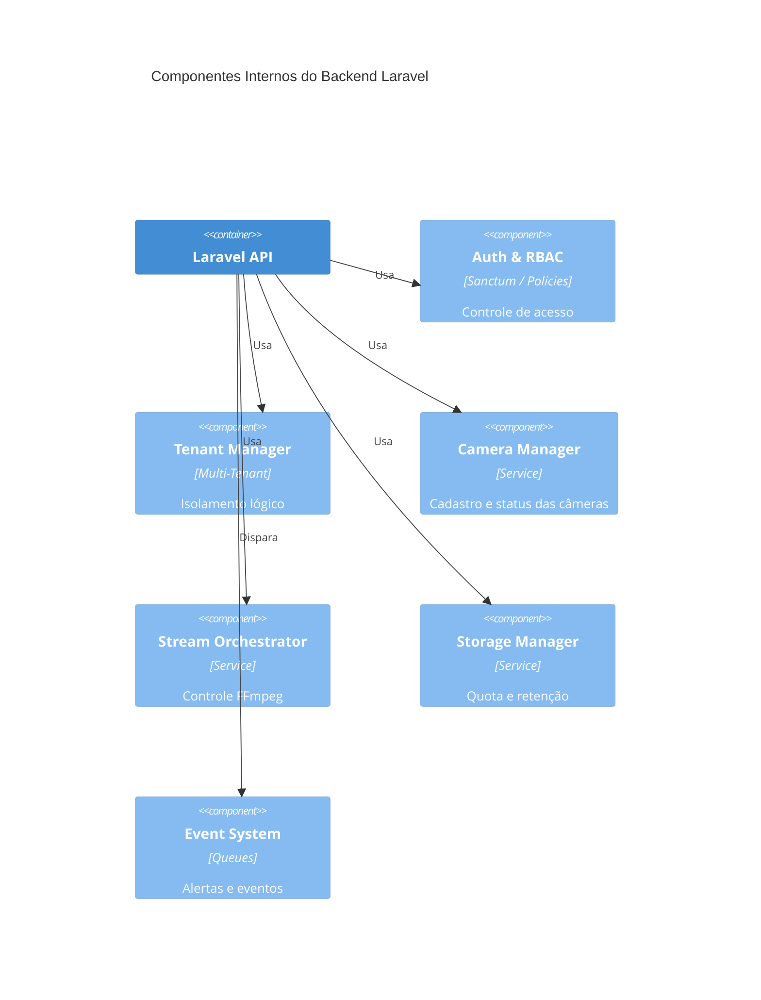
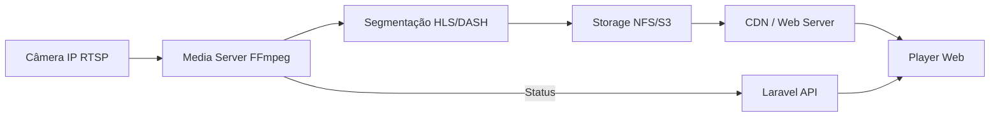
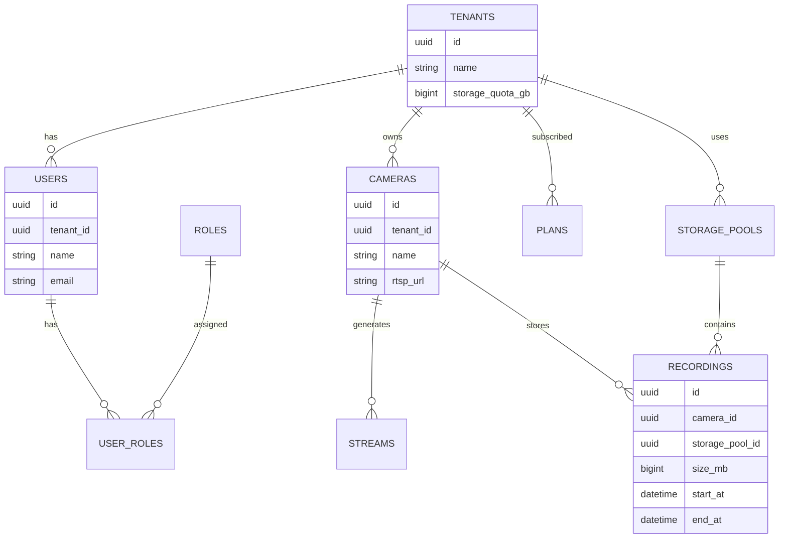

# ZyraVision — Plataforma Profissional de Monitoramento CFTV com Laravel

## 1. Contexto e Objetivo do Projeto

Atue como um **arquiteto de software e DevOps sênior**, com ampla experiência em **sistemas de vídeo, streaming, CFTV, infraestrutura crítica, alta disponibilidade e sistemas distribuídos**.

O objetivo é **projetar e desenvolver do zero** uma **plataforma profissional e avançada de monitoramento CFTV**, capaz de gerenciar milhares de câmeras, realizar ingestão, processamento, gravação, reprodução e distribuição de vídeo em tempo real, com **alto desempenho, baixa latência, escalabilidade horizontal e compatibilidade com múltiplas infraestruturas**.

A plataforma deverá ser construída **prioritariamente com Laravel**, aproveitando seu ecossistema maduro, ampla adoção no mercado e alta compatibilidade com ferramentas modernas, IA e automação.

---

## 2. Problemas Atuais a Serem Resolvidos

- Dependência de **softwares CFTV proprietários baseados em Windows**
- Incompatibilidade com **infraestrutura Linux**
- Sistemas legados usando **IDE/SATA local** sem suporte a clusters
- Falta de compatibilidade com **storage distribuído (SSH, NFS, CIFS, S3)**
- Baixa flexibilidade para operar em **VPS, Docker, Bare Metal, NAS ou Cloud**
- Dificuldade de automação, integração e escalabilidade

---

## 3. Premissas da Plataforma

- 100% **Linux-based**
- **Cloud-agnostic** (on‑premise, híbrido ou cloud)
- Compatível com **Docker, Kubernetes, VPS e Bare Metal**
- Alta performance mesmo em ambientes pequenos
- Arquitetura **modular, desacoplada e escalável**
- APIs bem definidas para integração externa
- Desginer moderno, intuitivo, profissional, **responsivo**, **mobile-first** e **accessibility**
- **Performance** e **escalabilidade** 

---

## 4. Arquitetura Geral (Visão Macro)

### 4.1 Separação de Camadas

- **Frontend (Web / Mobile)**
- **Backend (Laravel API / Control Plane)**
- **Media Services (Streaming & Transcoding)**
- **Storage Layer (Local / NAS / Cloud)**
- **Infra & Observabilidade**

---

## 5. Backend – Laravel como Control Plane

Laravel atuará como o **cérebro do sistema**, não como processador de vídeo pesado.

### Responsabilidades do Laravel:

- Autenticação (RBAC, Multi‑Tenant)
- Cadastro e gerenciamento de câmeras
- Gestão de streams e pipelines
- Orquestração de serviços FFmpeg / GStreamer
- Agendamento de gravações
- Regras de retenção
- Indexação de vídeos
- APIs REST e WebSocket
- Integração com filas e eventos

### Tecnologias Laravel:

- Laravel 10+
- Laravel Octane (Swoole / RoadRunner)
- Laravel Horizon (Redis Queues)
- Laravel Sanctum / Passport
- Laravel WebSockets
- Laravel Scout (busca)

---

## 6. Ingestão de Vídeo (Câmeras → Sistema)

### Protocolos Suportados:

- **RTSP** – Protocolo padrão de câmeras IP
- **RTMP** – Ingestão de streams ao vivo
- **SRT** – Transmissões seguras e resilientes
- **ONVIF** – Descoberta e controle de câmeras

### Ferramentas de Ingestão:

- **FFmpeg** (principal)
- **GStreamer** (opcional para pipelines avançados)
- **MediaMTX (rtsp-simple-server)**
- **Nginx RTMP Module**

Laravel apenas **orquestra**, quem processa vídeo são serviços dedicados.

---

## 7. Processamento e Transcodificação

### FFmpeg – Papel Central

- Conversão de RTSP → HLS/DASH
- Segmentação de vídeo
- Transcodificação multi‑bitrate
- Extração de snapshots
- Detecção de perda de frames

### Codecs Suportados:

- H.264 (AVC)
- H.265 (HEVC)
- VP9 / AV1 (futuro)

### Aceleração por Hardware:

- VAAPI
- NVENC / NVDEC
- Intel Quick Sync

---

## 8. Distribuição de Vídeo (Playback)

### Protocolos de Entrega:

- **HLS** – Compatível com navegadores
- **MPEG-DASH** – Streaming adaptativo
- **WebRTC** – Ultra baixa latência

### Players Frontend:

- Video.js
- hls.js
- Shaka Player
- WebRTC Player customizado

---

## 9. Armazenamento de Vídeo

### Tipos de Storage Suportados:

#### Local / On‑Premise

- SSD / NVMe
- RAID
- ZFS
- XFS

#### Network Storage

- NFS
- CIFS / SMB
- iSCSI
- NAS dedicado

#### Object Storage

- Amazon S3
- MinIO (on‑premise)
- Azure Blob
- Google Cloud Storage

### Abordagem de Gravação:

- Segmentação por tempo
- Metadados em banco
- Retenção configurável
- Cold / Hot Storage

---

## 10. Banco de Dados

### Relacional (Core):

- PostgreSQL

### Cache e Tempo Real:

- Redis

### Time‑Series (Opcional):

- InfluxDB (status de streams)

---

## 11. Multi-Tenant, Usuários, Perfis e Quotas (Modelo usado em grandes sistemas CFTV)

### 11.1 Arquitetura Multi-Tenant

A plataforma deve ser projetada desde o início como **Multi-Tenant**, permitindo que múltiplos clientes, empresas ou usuários coexistam no mesmo sistema, com **isolamento lógico total de dados**.

Modelos possíveis:
- Multi-tenant por **tenant_id** (mais comum e escalável)
- Isolamento por organização / cliente
- Possibilidade de single-tenant para grandes clientes

---

### 11.2 Usuários, Perfis e Papéis (RBAC)

O sistema deve possuir um **modelo avançado de usuários**, inspirado em plataformas profissionais de CFTV.

#### Tipos de Usuários:
- Super Admin (plataforma)
- Admin do Cliente
- Operador
- Visualizador (read-only)

#### Controle de Acesso:
- RBAC (Role-Based Access Control)
- Permissões granulares por:
  - Visualização de câmeras
  - Playback
  - Download de vídeos
  - Configuração de câmeras
  - Gestão de usuários

---

### 11.3 Perfis de Serviço (Planos)

O sistema deve permitir criar **Perfis de Serviço** (plans / tiers), onde cada perfil define os limites do usuário ou organização.

Cada perfil pode conter:

- Quantidade máxima de câmeras
- Espaço total de armazenamento (GB/TB)
- Retenção de gravações (dias)
- Resolução máxima permitida
- FPS máximo
- Quantidade de streams simultâneos
- Acesso a recursos avançados (AI, analytics, WebRTC, etc.)

Exemplos:
- Básico
- Profissional
- Enterprise

---

### 11.4 Associação de Câmeras por Usuário

- Cada câmera pertence a um **tenant / organização**
- Câmeras podem ser:
  - Compartilhadas entre usuários
  - Exclusivas de um usuário

Controle por:
- Grupo de câmeras
- Tags
- Localização

---

### 11.5 Gestão de Armazenamento por Usuário / Tenant

O sistema deve implementar **quota de armazenamento**, similar a grandes VMS do mercado.

Funcionalidades:

- Limite de armazenamento por usuário ou organização
- Monitoramento de uso em tempo real
- Bloqueio ou rotação automática ao atingir limite
- Políticas de retenção por perfil
- Separação lógica de diretórios

Exemplo de estrutura:

- /storage/tenant_001/
- /storage/tenant_002/

Ou buckets separados no S3 / MinIO.

---

### 11.6 Estratégias Profissionais de Retenção

- FIFO (First In, First Out)
- Retenção por tempo
- Retenção por evento
- Retenção diferenciada por câmera

---

### 11.7 Auditoria e Compliance

- Logs de acesso a streams
- Logs de download de vídeos
- Auditoria de ações de usuários

Esses recursos são obrigatórios em **ambientes corporativos e regulados**.

---

## 12. Frontend

### Tecnologias:

- Vue.js ou React
- WebSockets para live status
- Players HLS/DASH
- Timeline de gravações

### Funcionalidades:

- Live View
- Playback
- Mosaico de câmeras
- Alertas em tempo real
- Health das câmeras

---

## 13. Infraestrutura e Deploy

### Ambientes:

- Docker Compose
- Kubernetes
- VPS
- Bare Metal

### CI/CD:

- GitHub Actions
- GitLab CI
- Blue/Green Deploy

---

## 14. Observabilidade e Monitoramento

- Prometheus
- Grafana
- Loki
- Elastic Stack

Métricas:
- FPS
- Latência
- Uso de disco
- Saúde dos streams

---

## 15. Segurança

- TLS
- RBAC
- Isolamento de streams
- SRT encryption
- Hardening Linux

---

## 16. Conclusão

Sim, **é totalmente viável criar um sistema CFTV profissional e avançado usando Laravel**, desde que:

- Laravel seja o **control plane**
- Processamento pesado fique em **serviços especializados**
- Infraestrutura seja pensada desde o início

Essa abordagem é utilizada por **grandes plataformas de vídeo modernas**.

---

## 17. Diagramas de Arquitetura (Modelo C4)

### 17.1 Diagrama C4 – Nível 1 (Contexto do Sistema)



---

### 17.2 Diagrama C4 – Nível 2 (Containers)



---

### 17.3 Diagrama C4 – Nível 3 (Componentes do Backend)



---

### 17.4 Diagrama de Fluxo – Vídeo RTSP até Playback



---

## 18. Modelo de Banco de Dados (ERD – Visão Profissional)

### 18.1 Entidades Principais



---

## 19. Estrutura Real de Pastas – Laravel (Produção)

```text
app/
 ├── Domains/
 │   ├── Auth/
 │   ├── Tenant/
 │   ├── Camera/
 │   ├── Stream/
 │   ├── Storage/
 │   └── User/
 │
 ├── Http/
 │   ├── Controllers/
 │   ├── Middleware/
 │   └── Requests/
 │
 ├── Jobs/
 ├── Events/
 ├── Listeners/
 ├── Policies/
 ├── Services/
 └── Models/

routes/
 ├── api.php
 └── web.php

storage/
 ├── tenants/
 │   ├── tenant_001/
 │   └── tenant_002/
```

---

## 20. Contratos de API (OpenAPI – Exemplo)

```yaml
openapi: 3.0.0
info:
  title: Plataforma CFTV API
  version: 1.0.0

paths:
  /api/cameras:
    get:
      summary: Listar câmeras
      responses:
        '200':
          description: OK

  /api/streams/{id}/start:
    post:
      summary: Iniciar stream
      responses:
        '202':
          description: Stream iniciado
```

---

## 21. Pipeline FFmpeg Real (Exemplo de Produção)

### RTSP → HLS

```bash
ffmpeg -rtsp_transport tcp \
 -i rtsp://camera \
 -c:v copy \
 -f hls \
 -hls_time 4 \
 -hls_list_size 5 \
 -hls_flags delete_segments \
 /storage/tenant_001/cam01/index.m3u8
```

---

## 22. Cálculo Real de Disco por Câmera

### Exemplo Prático

- Bitrate: 4 Mbps
- Consumo por hora: ~1.8 GB
- Consumo por dia: ~43 GB
- 30 dias: ~1.3 TB por câmera

### Fórmula:

```
Storage (GB/dia) = (bitrate Mbps × 3600 × 24) / 8 / 1024
```

---

## 23. Transformação em MVP Executável (Roadmap Técnico)

### 23.1 Objetivo do MVP

Criar um **MVP funcional, executável e demonstrável**, capaz de:

- Gerenciar usuários e tenants
- Cadastrar câmeras RTSP
- Ingerir vídeo em tempo real
- Gravar segmentos em storage
- Reproduzir live e playback via web
- Aplicar limites de câmeras e armazenamento

O MVP deve ser **simples, estável e escalável**, sem complexidade desnecessária.

---

### 23.2 Stack Técnica do MVP

**Backend / Control Plane**
- Laravel 10+
- Laravel Sanctum
- Redis (Queues)
- PostgreSQL

**Media Layer**
- FFmpeg
- MediaMTX (RTSP Server)

**Frontend**
- Vue 3 + Vite
- Video.js + hls.js

**Storage**
- Local SSD / NFS
- MinIO (S3-compatible)

**Infra**
- Docker Compose (MVP)

---

### 23.3 MVP – Fases de Implementação

#### Fase 1 – Base do Sistema

- Autenticação
- Multi-Tenant
- CRUD de usuários
- Perfis e quotas

#### Fase 2 – Câmeras e Streams

- Cadastro RTSP
- Health check (FFmpeg probe)
- Start / Stop de streams
- Status em tempo real

#### Fase 3 – Gravação e Playback

- Pipeline FFmpeg
- Segmentação HLS
- Armazenamento por tenant
- Timeline de gravações

#### Fase 4 – Observabilidade

- Logs de stream
- Uso de disco
- Alertas básicos

---

## 24. Suporte a Inteligência Artificial (AI Video Analytics)

### 24.1 Princípio Fundamental (Como sistemas profissionais fazem)

Sistemas CFTV modernos **NÃO tratam GPU como detalhe**, ela é parte explícita da arquitetura.

A utilização de IA deve considerar:

- Processamento em **CPU**, **GPU** ou **Edge**
- Disponibilidade de drivers de vídeo
- Isolamento do processamento de IA
- Escalonamento independente

Laravel **apenas orquestra**, nunca processa IA diretamente.

---

### 24.2 Modos de Execução de IA (Modelos usados no mercado)

#### Modo 1 – CPU Only (Compatibilidade Máxima)

- Utiliza OpenCV + modelos otimizados
- Menor desempenho
- Ideal para ambientes pequenos

#### Modo 2 – GPU (CUDA / VAAPI / OpenCL)

- NVIDIA GPU (CUDA / TensorRT)
- Intel iGPU (VAAPI / OpenVINO)
- AMD GPU (ROCm / OpenCL)

Este é o **modo padrão em sistemas profissionais**.

#### Modo 3 – Edge AI (Distribuído)

- Processamento no próprio NVR ou Edge Device
- Reduz carga central
- Escala melhor

---

### 24.3 Drivers e Dependências de Vídeo

O sistema deve suportar explicitamente:

#### NVIDIA
- NVIDIA Driver
- CUDA Toolkit
- cuDNN
- TensorRT (opcional)

#### Intel
- Intel Media Driver
- VAAPI
- OpenVINO

#### AMD
- ROCm
- OpenCL

Esses drivers **não são parte do Laravel**, mas da infraestrutura.

---

### 24.4 Arquitetura Correta com GPU

```text
Camera → FFmpeg → Frames → AI Service (GPU) → Events → Laravel
```

- FFmpeg pode usar **GPU para decode**
- AI Service usa **GPU para inferência**
- Laravel apenas consome eventos

---

### 24.5 Integração com Docker e VM

#### Docker

- Uso de `nvidia-container-toolkit`
- Containers com acesso à GPU
- Isolamento por serviço de AI

#### Virtual Machines

- GPU Passthrough (PCI Passthrough)
- SR-IOV (quando disponível)
- Drivers instalados no host

---

### 24.6 Exemplo – Docker Compose com GPU

```yaml
services:
  ai-service:
    image: cftv-ai:latest
    deploy:
      resources:
        reservations:
          devices:
            - capabilities: [gpu]
```

---

### 24.7 Configuração por Câmera / Tenant

O sistema deve permitir:

- Ativar/desativar AI por câmera
- Escolher modelo de AI por câmera
- Limitar FPS enviado para AI
- Definir prioridade de GPU

Isso é **exatamente como Shinobi, Nx Witness e Genetec operam**.

---

### 24.8 Monitoramento de GPU

- Uso de GPU
- Temperatura
- Memória utilizada
- FPS de inferência

Ferramentas:
- NVIDIA SMI
- Prometheus Exporters

---

### 24.9 Segurança e Isolamento

- Containers isolados
- Limite de recursos
- Nenhum acesso direto ao banco

---

### 24.10 Arquitetura Geral de AI

A AI **não deve rodar dentro do Laravel**.

Ela será implementada como **microserviços especializados**, integrados via API ou filas.

```text
Camera → FFmpeg → Frames → AI Service → Events → Laravel
```

---

### 24.11 Casos de Uso de AI no CFTV

- Detecção de movimento
- Detecção de pessoas
- Reconhecimento facial
- Leitura de placas (LPR / ANPR)
- Contagem de pessoas
- Alertas inteligentes

---

### 24.12 Tecnologias de AI Recomendadas

**Frameworks**
- OpenCV
- PyTorch
- TensorFlow

**Modelos Prontos**
- YOLOv8 (detecção)
- OpenALPR (placas)
- DeepFace / FaceNet

---

### 24.13 Pipeline Técnico de AI (Exemplo)

```bash
# Extração de frames
ffmpeg -i stream.m3u8 -vf fps=1 frames/frame_%04d.jpg

# Processamento AI
python detect.py frames/
```

---

### 24.14 Integração AI ↔ Laravel

- Eventos enviados via REST ou Redis
- Laravel registra:
  - Tipo de evento
  - Timestamp
  - Câmera
  - Metadata

Exemplo:

- Movimento detectado
- Placa identificada
- Pessoa reconhecida

---

### 24.15 Armazenamento de Eventos AI

- Banco relacional (eventos)
- Storage para snapshots
- Associação com gravações

---

### 24.16 Alertas Inteligentes

- WebSocket
- Push notification
- Webhook
- Integração com sistemas externos

---

## 25. Design System e Padronização Visual (Padrão Profissional)

### 25.1 Princípio Fundamental

Em sistemas profissionais e de grande escala, **não se desenvolve telas de forma isolada**. Todo o frontend deve seguir um **Design System centralizado**, garantindo:

- Consistência visual
- Manutenibilidade
- Escalabilidade
- Experiência de usuário uniforme

A IA **não deve criar estilos livres por tela**. Ela deve **seguir rigorosamente um padrão definido**.

---

### 25.2 Abordagem Usada em Grandes Projetos

A plataforma deve adotar um **Design System**, similar ao utilizado por:

- Material Design (Google)
- Carbon Design System (IBM)
- Ant Design
- Chakra UI
- Design Systems proprietários (VMS, ERPs, SaaS)

Esse Design System será a **fonte única da verdade visual**.

---

### 25.3 Elementos Obrigatórios do Design System

O Design System deve definir explicitamente:

#### Tema Global
- Paleta de cores primária, secundária e estados
- Tipografia (font-family, pesos, tamanhos)
- Espaçamentos (spacing scale)
- Bordas e radius
- Sombras

#### Componentes Base

- Botões (primary, secondary, danger, ghost)
- Inputs (text, select, checkbox, switch)
- Tabelas (listagem padrão)
- Cards
- Modais
- Alerts e badges
- Dropdowns
- Pagination

#### Estados Visuais
- Hover
- Focus
- Active
- Disabled
- Loading
- Error

---

### 25.4 Padronização de Listagens e Tabelas

Todas as telas de listagem devem usar:

- Componente único de tabela
- Ações padronizadas (view, edit, delete)
- Ícones consistentes
- Paginação padrão
- Filtros reutilizáveis

A IA **não deve criar tabelas diferentes em cada tela**.

---

### 25.5 Estrutura Técnica do Design System

#### Frontend

- Tailwind CSS ou equivalente
- Tokens de design (cores, espaçamento, fontes)
- Componentes reutilizáveis

Exemplo:

```text
ui/
 ├── theme/
 │   ├── colors.ts
 │   ├── spacing.ts
 │   ├── typography.ts
 │   └── shadows.ts
 ├── components/
 │   ├── Button.vue
 │   ├── Table.vue
 │   ├── Modal.vue
 │   └── Input.vue
```

---

### 25.6 Regras para a IA (Obrigatórias)

A IA deve seguir rigorosamente:

- Criar o **Design System primeiro**
- Não criar CSS inline
- Não criar estilos ad-hoc por tela
- Usar apenas componentes padronizados
- Manter consistência em cores, botões e layouts

Qualquer nova tela deve **reutilizar componentes existentes**.

---

### 25.7 Governança Visual

- Alterações no design ocorrem apenas no Design System
- Toda a aplicação herda automaticamente as mudanças
- Evita divergência visual ao longo do tempo

---

## 26. Missão Final da IA

Com base neste documento completo:

- Crie um MVP executável
- Respeite rigorosamente o Design System
- Utilize componentes reutilizáveis
- Mantenha identidade visual única
- Não crie estilos visuais divergentes

Este projeto deve se comportar como um **produto enterprise**, não como um conjunto de telas isoladas.


Com base neste documento completo:

- Gere um MVP executável
- Crie Docker Compose funcional
- Implemente pipelines FFmpeg
- Crie APIs REST
- Integre AI como microserviço
- Pense sempre em performance, segurança e escalabilidade

Este documento representa uma **plataforma CFTV profissional de nível enterprise**, pronta para evolução comercial.


Com base neste documento, gere:

- Arquitetura detalhada
- Diagramas
- Estrutura de pastas
- APIs
- Estratégias de escalabilidade
- Boas práticas de performance

Sempre considerando **ambientes reais de produção, CFTV crítico e alta disponibilidade**.


## 🧱 Stack Tecnológica Oficial (Versões Compatíveis e Homologadas)

Esta seção define **explicitamente** as versões de cada tecnologia que DEVEM ser utilizadas no projeto. O objetivo é:
- Evitar incompatibilidades
- Garantir estabilidade
- Impedir que a IA utilize versões experimentais ou não suportadas
- Garantir longevidade do MVP até produção

### 🎯 Princípios adotados
- Apenas **versões LTS ou amplamente estáveis**
- Stack validada para **Laravel + Inertia + Vue + Tailwind**
- Compatibilidade total com TypeScript
- Suporte sólido a Docker, Vite e ambiente Linux

---

## 🔧 Backend

### Laravel
- **Laravel 11.x (LTS)**
  - Compatível com PHP 8.2+
  - Melhor suporte a queues, events, jobs e APIs
  - Estrutura moderna e estável para MVP e escala

### PHP
- **PHP 8.2.x**
  - Compatível com Laravel 11
  - Melhor performance e tipagem
  - Amplo suporte em ambientes Docker

---

## 🎨 Frontend (Stack Oficial)

### Inertia.js
- **Inertia.js v1.x (estável)**
  - Ponte oficial entre Laravel e Vue
  - Evita SPA complexa sem necessidade
  - Ideal para sistemas administrativos e dashboards

### Vue.js
- **Vue 3.4.x (Composition API)**
  - Totalmente compatível com Inertia
  - Melhor suporte a TypeScript
  - Performance superior

### TypeScript
- **TypeScript 5.x**
  - Tipagem forte em componentes, props e stores
  - Redução de bugs em projetos grandes
  - Obrigatório no frontend

---

## 🎨 Estilização

### Tailwind CSS
- **Tailwind CSS 3.4.x**
  - Última versão **estável e amplamente compatível**
  - Total integração com Vite
  - Evita problemas conhecidos da versão 4.x (breaking changes)
  - Compatível com plugins, presets e Design System

> ⚠️ Regra explícita:
> NÃO utilizar Tailwind 4.x neste projeto até homologação futura.

### PostCSS
- **PostCSS 8.x** (padrão do Tailwind 3.4)

---

## ⚡ Build & Tooling

### Vite
- **Vite 5.x**
  - Build rápido
  - Integração nativa com Laravel 11
  - Suporte completo a Vue + TypeScript + Tailwind

### Node.js
- **Node.js 20 LTS**
  - Recomendado pelo ecossistema Laravel
  - Estável para Vite e Tailwind

---

## 🧩 UI / Design System

- Tailwind configurado via:
  - `tailwind.config.ts`
  - Tokens de tema (cores, espaçamentos, fontes)
- Componentes Vue reutilizáveis
- Nenhum CSS fora do Design System

---

## 📦 Stack Final Resumida (Obrigatória)

| Camada | Tecnologia | Versão |
|------|-----------|--------|
| Backend | Laravel | 11.x |
| Backend | PHP | 8.2.x |
| Frontend | Vue.js | 3.4.x |
| Bridge | Inertia.js | 1.x |
| Estilos | Tailwind CSS | 3.4.x |
| Tipagem | TypeScript | 5.x |
| Build | Vite | 5.x |
| Runtime JS | Node.js | 20 LTS |

---

## 🤖 Instruções Diretas para IA

A IA responsável por gerar código DEVE:

- Utilizar **exclusivamente** as versões listadas acima
- Não sugerir upgrades automáticos
- Não usar versões beta ou RC
- Respeitar o Design System
- Utilizar Composition API + TypeScript no Vue
- Não misturar Alpine.js neste projeto

> Qualquer desvio dessas versões é considerado erro de implementação.

---

Este stack foi escolhido para garantir **estabilidade, compatibilidade e padrão enterprise**, permitindo evolução futura sem retrabalho estrutural.


# 🔧 Melhorias Avançadas e Complementos Críticos (Enterprise CFTV)

## Gestão de Largura de Banda (Crítica para CFTV)

### Problemas a resolver
- Múltiplas câmeras consumindo banda simultaneamente
- Priorização de streams críticos
- Adaptive bitrate por câmera
- Throttling inteligente por tenant

### Implementação
- Transcoding dinâmico conforme carga do sistema
- Perfis de qualidade: Low / Medium / High / Ultra
- Agendamento de qualidade por horário
- Monitoramento contínuo de banda com alertas

### Técnicas
- FFmpeg com múltiplos outputs (multi-bitrate)
- HLS adaptativo
- MPEG-DASH com ABR
- Rate limiting por tenant/câmera

---

## Alta Disponibilidade e Disaster Recovery

### Cenários críticos
- Queda de storage principal
- Falha de media server
- Perda de conexão RTSP
- Corrupção de gravações

### Soluções

#### Storage Redundante
- Replicação Primary + Backup
- Failover automático
- Verificação de integridade (checksums)

#### Media Server Clustering
- Pool de FFmpeg workers
- Health checks contínuos
- Load balancer inteligente

#### Gravação em Edge
- Buffer local em caso de falha
- Store-and-forward
- Detecção automática de gaps

#### Monitoramento Proativo
- Heartbeat ONVIF
- Alertas < 30s
- Auto-recovery de streams

---

## Sistema de Busca e Timeline Profissional

### Funcionalidades
- Busca por data/hora
- Busca por eventos de IA
- Busca por movimento
- Busca por câmera/local
- Exportação de clipes

### Metadados Estruturados
- Uso intensivo de timestamps
- Eventos associados a gravações
- Thumbnails indexados

### Busca Rápida
- Elasticsearch ou MeiliSearch
- PostgreSQL JSONB
- Índices temporais
- Cache agressivo de thumbnails

---

## Exportação de Vídeos e Chain of Custody

### Requisitos
- Hash SHA-256
- Marca d’água
- Metadados completos
- Auditoria completa

### Auditoria
- Registro de exportações
- Assinatura digital opcional
- Compatibilidade jurídica

---

## Integração com Dispositivos Físicos

### Suporte
- DVRs/NVRs legados
- Sensores e alarmes
- Controle PTZ (ONVIF)
- Portões e catracas

### Protocolos
- ONVIF
- MQTT
- Modbus TCP
- Webhooks
- WebSockets

---

## Licenciamento de Software e Codecs

### Atenção Legal
- H.264 / H.265 com royalties
- FFmpeg GPL/LGPL

### Alternativas
- VP9
- AV1

---

## Performance e Otimizações

### Banco de Dados
- Particionamento por data
- Índices compostos
- Archiving automático

### Cache
- Redis para status e thumbnails

### CDN
- HLS/DASH via CDN

### Background Jobs
- Transcoding
- Thumbnails
- Notificações

---

## Segurança Avançada

### Medidas
- VLAN isolada
- TLS 1.3
- Criptografia AES-256
- Zero Trust
- SIEM (ELK/Wazuh)

---

## Estratégia de Testes

- Unitários (Pest/PHPUnit)
- Integração (FFmpeg/Storage)
- Carga (k6/JMeter)
- E2E (Cypress/Playwright)
- Monitoramento sintético

---

## Documentação Viva

- README técnico
- ADRs
- Runbooks SRE
- OpenAPI 3.0
- Manual do usuário

---

## Roadmap Pós-MVP

### Fase 2
- Mapas interativos
- Apps mobile
- LPR

### Fase 3
- Analytics
- Heatmaps
- Relatórios

### Fase 4
- Integrações ERP/CRM

### Fase 5
- IA avançada

---

## Checklist de Validação do MVP

### Backend
- Auth e RBAC
- Multi-tenancy
- Ingestão RTSP
- Playback
- Quotas

### Frontend
- Design System
- Live view
- Timeline
- Mosaico

### Infra
- Docker
- PostgreSQL
- Redis
- Storage

### Segurança
- HTTPS
- Rate limit
- Auditoria

### Performance
- Cache
- Queries <100ms
- Jobs async

---

## Conclusão

Este documento agora representa uma **especificação enterprise completa** para um VMS/CFTV moderno, resiliente, seguro, escalável e preparado para IA, atendendo ambientes pequenos até grandes datacenters.


# ✅ Checklist Mestre do Projeto CFTV (Guia de Execução para IA)

> Este checklist serve como **controle absoluto de progresso**. A IA deve seguir **rigorosamente a ordem**, marcar itens concluídos e **não avançar etapas sem validação**.

---

## 🧭 FASE 0 — Planejamento e Fundamentos

- [x] Ler integralmente este documento antes de gerar código
- [x] Confirmar stack oficial (Laravel, Vue, Inertia, Tailwind, TS)
- [x] Confirmar versões travadas
- [x] Confirmar requisitos de infra (CPU, GPU, storage, rede)
- [x] Validar cenários: small / medium / enterprise
- [x] Registrar decisões em ADR (Architecture Decision Record)

---

## 🎨 FASE 1 — Design System (Obrigatório antes de telas)

### Tema Global
- [x] Definir paleta de cores oficial
- [x] Definir tipografia padrão
- [x] Definir espaçamentos (scale)
- [x] Definir bordas, radius e sombras
- [x] Definir estados (hover, active, disabled, loading)

### Componentes Base
- [x] Button (primary, secondary, danger, ghost)
- [x] Input / Select / Textarea
- [x] Table padronizada
- [x] Card / Panel
- [x] Modal
- [x] Alert / Toast
- [x] Badge / Status indicator

### Regras
- [x] Proibir CSS inline
- [x] Proibir estilos por tela
- [x] Garantir reutilização de componentes

---

## 🏗️ FASE 2 — Setup do Projeto Base

### Backend
- [x] Criar projeto Laravel
- [x] Configurar PHP 8.2+
- [x] Configurar autenticação (Sanctum)
- [x] Configurar RBAC (roles/permissions)
- [x] Configurar multi-tenancy

### Frontend
- [x] Inertia.js configurado
- [x] Vue 3 + TypeScript
- [x] Tailwind com Design System
- [x] Layout base (sidebar + header)

---

## 👥 FASE 3 — Usuários, Perfis e Quotas

- [x] CRUD de usuários (Index, Create, Edit, Show, Delete)
- [x] Sistema de perfis/planos (Plan model + Subscription + 3 planos: Starter, Professional, Enterprise)
- [x] Limite de câmeras por plano (quota_usages + barras de progresso)
- [x] Limite de armazenamento por plano (storage_gb quota tracking)
- [x] Limite de usuários por plano (quota enforcement via Plan model)
- [x] Limite de streams simultâneos por plano
- [x] Políticas de acesso por câmera (RBAC via Spatie Permissions)
- [x] Auditoria de ações (Activity Log page com filtros)
- [x] Página de Perfil do usuário com quotas e assinatura
- [x] Dashboard com consumo de recursos e status da assinatura
- [x] Sistema de assinatura (Subscription model com status: active, trial, cancelled, expired)
- [x] Tenants CRUD com gestão de planos e quotas (Show com barras de progresso)

---

## 📷 FASE 4 — Gestão de Câmeras e Dispositivos ✅

### Cadastro de Câmeras
- [x] CRUD de câmeras (Index, Create, Edit, Show, Delete)
- [x] Suporte a câmeras IP diretas (standalone)
- [x] Tipos de endereço: IPv4, IPv6, DDNS, Hostname (ADR-0029)
- [x] Endereço secundário para fallback automático
- [x] Transporte configurável: TCP / UDP / Auto

### Suporte a DVRs/NVRs como Dispositivos (ADR-0030)
- [x] Model Device (DVR, NVR, Encoder, Híbrido, Camera IP)
- [x] Relacionamento Device → múltiplos Canais (Cameras)
- [x] Auto-discovery de canais ativos no DVR
- [x] Criação automática de câmeras a partir dos canais descobertos
- [x] Gerenciamento em lote (credenciais, ativar/desativar canais)
- [x] Re-sincronização de canais (detectar novos, remover inativos)
- [x] Health check por dispositivo e por canal individual

### Suporte IPv6 e DDNS (ADR-0029)
- [x] Dual-Stack IPv4/IPv6 nativo em toda a cadeia de conexão
- [x] Suporte CGNAT / DS-Lite (redes IPv6-only)
- [x] Resolução de endereços DDNS com cache inteligente
- [x] Providers DDNS: No-IP, DynDNS, DuckDNS, Intelbras DDNS, Hikvision Hik-Connect, Dahua DMSS, Custom
- [x] Fallback automático IPv6 → IPv4 (Happy Eyeballs)
- [x] URLs RTSP com notação IPv6: `rtsp://[2001:db8::1]:554/path`

### Compatibilidade Multi-Fabricante (ADR-0031)
- [x] Sistema de Manufacturer Profiles (perfis por fabricante)
- [x] Auto-detect de fabricante (ONVIF, HTTP fingerprint, RTSP banner)
- [x] Paths RTSP pré-configurados por fabricante (main/sub stream)
- [x] Captura de snapshot por fabricante

#### Fabricantes Suportados

**Tier 1 — Prioridade Máxima (Mercado BR):**
Intelbras, Hikvision, Dahua, Giga, Tecvoz

**Tier 2 — Alta Prioridade:**
AXIS, Bosch, Hanwha (Samsung), Uniview, JFL, CPPlus

**Tier 3 — Suporte Padrão:**
ALIVE, AMCREST, AVTech, Avigilon, CLEAR, D-Link, Eneo, FICO, FOSCAM, GREATEK, GeoVision, HDL, JORTAN, LG, Luxvision, MULTILASER, Panasonic, TRENDnet, TWG, Tenda, VENETIAN, VIVOTEK, Viewtron, ZAVIO

**Generic:** Qualquer câmera/DVR com RTSP ou ONVIF (URL customizada)

### Protocolos e Conectividade
- [x] Suporte RTSP (TCP/UDP) com autenticação Basic e Digest
- [x] ONVIF discovery (Profiles S, T, G)
- [x] Health check da câmera (TCP port + RTSP OPTIONS)
- [x] Heartbeat periódico com alertas de offline
- [x] Controle PTZ (quando disponível via ONVIF ou API do fabricante)
- [x] Captura de snapshot sob demanda

### Visualizacao e Streaming (Show Page)
- [x] Player HLS com hls.js + fallback snapshot
- [x] Exibicao de URLs de streaming (RTSP, RTMP, HLS, HLS shift, MP4 export)
- [x] Informacoes de Pack (HLS, fMP4, Low Latency)
- [x] Informacoes de armazenamento do dispositivo
- [x] StreamUrlResolver service (computa URLs a partir de fabricante + endereco)
- [x] Suporte RTMP (RtmpUrlBuilder service)

### Super Admin — Acesso Global
- [x] Super-admin sem tenant (tenant_id = NULL, acesso global)
- [x] Dashboard Admin dedicado (stats globais, saude do sistema, cameras de todos os tenants)
- [x] Perfil do super-admin sem cards de plano/consumo (sidebar com visao da plataforma)
- [x] Controllers com acesso global para super-admin (cameras, devices, audit)

---

## FASE 5 — Ingestao e Streaming

### Infraestrutura de Streaming
- [x] MediaMTX container (RTSP proxy + HLS + WebRTC)
- [x] Configuracao MediaMTX (segmentos, LL-HLS, timeouts)
- [x] Nginx proxy para HLS/WebRTC
- [x] Volume de armazenamento de video
- [x] Config centralizada (config/streaming.php)

### Pipeline de Video
- [x] MediaMTX Client service (API HTTP)
- [x] StreamManager (orquestrador: start/stop/restart)
- [x] Resolucao RTSP → MediaMTX path automatica
- [x] Geracao automatica de URLs HLS/WebRTC

### Jobs e Monitoramento
- [x] StartStreamJob (fila "streaming")
- [x] StopStreamJob
- [x] MonitorStreamsJob (scheduled 30s, health check, auto-reconnect)
- [x] CaptureSnapshotJob (scheduled 5min, FFmpeg)
- [x] Eventos: StreamStarted, StreamStopped, StreamFailed

### Database
- [x] Model Stream (status, mediamtx_path, hls_url, metricas)
- [x] Model Recording (storage_path, duration, file_size)
- [x] Migracoes para streams e recordings

### API e Rotas
- [x] POST /cameras/{camera}/stream/start
- [x] POST /cameras/{camera}/stream/stop
- [x] GET /cameras/{camera}/stream (status)

### Frontend
- [x] ZyVideoPlayer com HLS ao vivo (auto-play, badge LIVE, auto-reconnect)
- [x] Camera Show: botoes Iniciar/Parar Stream
- [x] Camera Show: player live quando stream ativo com metricas
- [x] Dashboard: cameras com stream ativo mostram video real + badge LIVE
- [x] Tipos TypeScript atualizados (Stream, Recording)

### Transcoding e Qualidade
- [x] HLS segmentos de 4s, playlist de 5 segmentos
- [x] LL-HLS (Low Latency) habilitado
- [x] Copy codec (sem re-encoding para economizar CPU)
- [x] Monitoramento de banda e metricas via MediaMTX API

---

## 💾 FASE 6 — Gravação e Armazenamento

### 6D — Design System (Componentes de Suporte) ✅

- [x] **ZyProgressBar** — Barra de progresso com variantes (primary, success, warning, danger, auto)
  - Props: `value`, `max`, `variant`, `size` (sm/md/lg), `showLabel`, `label`
  - Auto-color: verde <70%, amarelo 70-89%, vermelho 90%+
  - Acessibilidade: `role="progressbar"` + `aria-valuenow`
- [x] **ZyTabs** — Componente de abas com slots dinâmicos
  - Props: `tabs` (Tab[]), `modelValue` (v-model), `variant` (underline/pills)
  - Tab: `{ key, label, icon?, badge?, disabled? }`
  - Slots dinâmicos: `<slot :name="tab.key" />`
  - Acessibilidade: `role="tablist"` + `role="tab"` + `aria-selected`
- [x] Export dos componentes em `resources/js/DesignSystem/index.ts`

### 6A — Infraestrutura de Gravação (Backend) ✅

#### Configuração MediaMTX
- [x] `docker/mediamtx/mediamtx.yml` — Configuração de gravação nativa
  - `record: no` (desabilitado por padrão, habilitado per-path via API)
  - `recordPath: /recordings/%path/%Y-%m-%d/%H-%M-%S`
  - `recordFormat: fmp4` (fragmented MP4)
  - `recordSegmentDuration: 5m` (segmentos de 5 minutos)
  - `recordDeleteAfter: 0` (Laravel gerencia retenção)

#### Docker & Volumes
- [x] `docker-compose.yml` — Volume `videodata:/recordings` montado em:
  - Container `app` (PHP-FPM)
  - Container `queue` (Horizon workers)
  - Container `scheduler` (Laravel Scheduler)
  - Container `mediamtx` (já existia)

#### Configuração Laravel
- [x] `config/streaming.php` — Seção `recording` adicionada:
  - `enabled`, `format` (fmp4), `segment_duration` (5m)
  - `base_path` (/recordings), `default_retention_days` (30)
  - `scan_interval_seconds` (60)

#### RecordingManager Service
- [x] `app/Services/Recording/RecordingManager.php` — Serviço principal:
  - `startRecording(Camera)` — Verifica stream ativo + quota → habilita `record: true` via API MediaMTX → cria Recording → atualiza `camera.is_recording`
  - `stopRecording(Camera)` — Desabilita `record: false` → marca Recording como `completed` → atualiza `camera.is_recording`
  - `scanSegments(Camera)` — Escaneia filesystem por .mp4 → atualiza `file_size_bytes` e `duration_seconds` → atualiza QuotaUsage
  - `isRecording(Camera)` — Verifica flag local + API MediaMTX
  - `calculateTenantStorage(Tenant)` — Soma `file_size_bytes` das recordings ativas
  - `cleanupExpiredRecordings(Tenant)` — Deleta recordings mais antigas que `retention_days` + remove arquivos do disco

#### MediaMtxClient (Playback)
- [x] `app/Services/Streaming/MediaMtxClient.php` — Métodos adicionados:
  - `listRecordings(path, start?, end?)` — `GET /playback/list`
  - `getPlaybackUrl(path, start, end?)` — Retorna URL de playback HLS

#### Jobs de Gravação
- [x] `app/Jobs/StartRecordingJob.php` — Dispatch manual, queue `streaming`
- [x] `app/Jobs/StopRecordingJob.php` — Dispatch manual, queue `streaming`
- [x] `app/Jobs/ScanRecordingSegmentsJob.php` — `everyMinute()`, escaneia câmeras com `is_recording=true`
- [x] `app/Jobs/CleanupExpiredRecordingsJob.php` — `dailyAt('03:00')`, remove gravações expiradas por tenant
- [x] `app/Jobs/UpdateStorageQuotaJob.php` — `everyFifteenMinutes()`, recalcula `storage_gb` por tenant

#### Events
- [x] `app/Events/RecordingStarted.php` — Disparado ao iniciar gravação
- [x] `app/Events/RecordingStopped.php` — Disparado ao parar gravação

#### Scheduler
- [x] `routes/console.php` — Jobs agendados:
  - `ScanRecordingSegmentsJob` → a cada minuto
  - `CleanupExpiredRecordingsJob` → diariamente às 03:00
  - `UpdateStorageQuotaJob` → a cada 15 minutos

#### RecordingController
- [x] `app/Http/Controllers/RecordingController.php` — Endpoints:
  - `POST /cameras/{camera}/recording/start` — Inicia gravação
  - `POST /cameras/{camera}/recording/stop` — Para gravação
  - `GET /cameras/{camera}/recording` — Status JSON
  - `GET /recordings` — Lista gravações (Inertia)
  - `GET /recordings/{recording}` — Detalhe + playback (Inertia)
  - `DELETE /recordings/{recording}` — Remove gravação
  - `GET /recordings/{recording}/playback` — URL playback JSON

#### Rotas
- [x] `routes/web.php` — Rotas de recording e storage dentro do grupo `auth`

#### Nginx Proxy
- [x] `docker/nginx/default.conf` — Proxy `/playback/` para MediaMTX:
  - `proxy_pass http://mediamtx:8888/playback/`
  - Basic Auth header passthrough
  - CORS headers

#### StreamManager Integration
- [x] `app/Services/Streaming/StreamManager.php` — Em `stopStream()`:
  - Se `camera.is_recording` → desabilita gravação → marca recording completed

### 6B — Dashboard de Armazenamento (Backend + Frontend) ✅

#### StorageController
- [x] `app/Http/Controllers/StorageController.php`:
  - `GET /storage` — Dashboard de armazenamento (Inertia)
  - `PUT /storage/retention` — Atualizar política de retenção
  - Suporte super-admin: seletor de tenant via `?tenant_id=`
  - Props: `storage`, `cameraStorage`, `retentionDays`, `planLimits`, `tenants`, `isSuperAdmin`, `currentTenantId`

#### Navegação
- [x] `resources/js/Layouts/AuthenticatedLayout.vue` — Item "Armazenamento" no menu com `CircleStackIcon`

#### Página Storage/Index.vue
- [x] `resources/js/Pages/Storage/Index.vue` — Dashboard com ZyTabs (3 abas):
  - **Visão Geral**: ZyProgressBar de uso total + cards de estatísticas (gravações, retenção, mais antiga) + top 5 câmeras por uso
  - **Por Câmera**: Tabela detalhada com ZyProgressBar por linha, link para câmera, badge de status
  - **Retenção**: Formulário com ZyInput para dias de retenção + botão salvar
  - Seletor de tenant (ZySelect) para super-admin no header

#### TypeScript Types
- [x] `resources/js/Types/index.d.ts` — Tipos `StorageSummary`, `CameraStorage` adicionados

### 6C — Interface de Gravações (Frontend) ✅

#### Recordings/Index.vue
- [x] `resources/js/Pages/Recordings/Index.vue` — Lista de gravações:
  - Filtros: busca por câmera, date range, status (recording/completed/failed)
  - ZyTable: Câmera, Início, Duração, Tamanho, Status, Ações
  - Status badges: recording→danger+dot, completed→success, failed→danger
  - ZyPagination + ZyConfirmDialog para exclusão
  - Seletor de tenant para super-admin

#### Recordings/Show.vue
- [x] `resources/js/Pages/Recordings/Show.vue` — Detalhe da gravação:
  - ZyVideoPlayer com URL de playback do MediaMTX (`isLive: false`)
  - Cards de metadados: câmera, datas, duração, tamanho, codec, resolução, fps
  - Botões: Download, Excluir (com ZyConfirmDialog)

#### Câmera Show: Controles de Gravação
- [x] `resources/js/Pages/Cameras/Show.vue` — Modificações:
  - Botão "Gravar" (vermelho com indicador) quando stream ativo e não gravando
  - Botão "Parar Gravação" quando gravando
  - Prop `:is-recording` no ZyVideoPlayer
  - Seção "Gravações Recentes" com últimas 5 recordings + link "Ver todas"
- [x] `app/Http/Controllers/CameraController.php` — `show()` passa `recentRecordings`

#### REC Badge no VideoPlayer
- [x] `resources/js/DesignSystem/ZyVideoPlayer.vue` — Modificações:
  - Nova prop `isRecording` (boolean)
  - Badge "REC" pulsante vermelho no canto superior direito (ao lado do "AO VIVO")
  - Animação `animate-ping` para indicador de gravação em tempo real

### 6E — Configuração de Backends de Armazenamento (Configurações do Sistema) 🔲

> **Status: NÃO IMPLEMENTADO** — Esta sub-fase cobre a configuração de backends de armazenamento nas configurações do sistema, permitindo que administradores escolham e configurem onde as gravações serão salvas.

#### 6E.1 — Model e Migration `StorageBackend`
- [x] Criar migration `create_storage_backends_table`:
  - `id` (UUID), `tenant_id` (FK), `name` (ex: "NAS Principal", "AWS S3 Backup")
  - `driver` (enum: local, nas, nfs, cifs, sftp, cdntv, lvm, minio, s3, azure_blob, custom)
  - `is_active` (boolean), `is_default` (boolean), `priority` (int, para failover)
  - `config` (JSON encrypted — armazena credenciais e parâmetros específicos do driver)
  - `health_status` (enum: healthy, degraded, offline, unknown)
  - `last_health_check_at` (timestamp)
  - `total_capacity_gb` (nullable), `used_capacity_gb` (nullable)
  - `timestamps`, `softDeletes`
- [x] Criar model `App\Models\StorageBackend` com casts JSON/encrypted para `config`

#### 6E.2 — Drivers de Armazenamento (Storage Drivers)
- [x] Criar interface `App\Contracts\StorageDriverInterface`:
  - `connect(): bool` — Testa conectividade
  - `store(string $path, string $contents): bool` — Salva arquivo
  - `retrieve(string $path): string` — Recupera arquivo
  - `delete(string $path): bool` — Remove arquivo
  - `exists(string $path): bool` — Verifica existência
  - `listFiles(string $directory): array` — Lista arquivos
  - `getCapacity(): array` — Retorna `['total_gb', 'used_gb', 'free_gb']`
  - `healthCheck(): array` — Retorna `['status', 'latency_ms', 'message']`

##### Armazenamento Local
- [x] **Driver Local (HDD/SSD)** — `App\Services\Storage\Drivers\LocalDriver`
  - Configuração: `base_directory` (ex: `/recordings`), `max_capacity_gb`
  - Verifica espaço em disco via `disk_free_space()` / `disk_total_space()`
  - Suporte a múltiplos diretórios/discos (ex: `/mnt/ssd1`, `/mnt/hdd1`)

- [x] **Driver LVM** — `App\Services\Storage\Drivers\LvmDriver`
  - Configuração: `volume_group`, `logical_volume`, `mount_point`, `max_capacity_gb`
  - Monitoramento de LV usage via `lvs` / `df`
  - Suporte a expansão automática de LV quando disponível

##### Armazenamento em Rede (NAS/Network)
- [x] **Driver NFS** — `App\Services\Storage\Drivers\NfsDriver`
  - Configuração: `server` (IP/hostname), `port` (2049), `export_path` (ex: `/volume1/recordings`)
  - `mount_point` (local), `nfs_version` (3/4/4.1), `mount_options` (rw, sync, hard, etc.)
  - `username`, `password` (para NFSv4 com Kerberos)
  - Health check: verifica se mount está ativo e acessível

- [x] **Driver CIFS/SMB** — `App\Services\Storage\Drivers\CifsDriver`
  - Configuração: `server` (IP/hostname), `port` (445), `share_name` (ex: `recordings`)
  - `mount_point`, `domain`, `username`, `password`
  - `smb_version` (2.0/2.1/3.0/3.1.1), `mount_options`
  - Suporte a Active Directory authentication

- [x] **Driver SFTP** — `App\Services\Storage\Drivers\SftpDriver`
  - Configuração: `server` (IP/hostname), `port` (22), `base_directory` (ex: `/home/recordings`)
  - `username`, `password` ou `private_key` (SSH key)
  - `key_passphrase` (opcional), `host_fingerprint` (verificação de host)
  - Usa `phpseclib3` ou Laravel Filesystem SFTP adapter

- [x] **Driver NAS Genérico** — `App\Services\Storage\Drivers\NasDriver`
  - Configuração: `protocol` (nfs/cifs/iscsi), `server`, `port`
  - `share_path`, `mount_point`, `username`, `password`
  - Wrapper que detecta e delega para NFS ou CIFS driver conforme protocolo

- [x] **Driver CDNTV** — `App\Services\Storage\Drivers\CdntvDriver`
  - Configuração: `server` (IP/hostname), `port`, `api_endpoint`
  - `username`, `password`, `api_key`
  - `base_directory`, `retention_policy`
  - Integração com APIs proprietárias de CDNs de vídeo

##### Armazenamento em Nuvem (Cloud Storage)
- [x] **Driver MinIO** — `App\Services\Storage\Drivers\MinioDriver`
  - Configuração: `endpoint` (ex: `http://minio.local:9000`), `port` (9000)
  - `access_key`, `secret_key`, `bucket` (ex: `zyravision-recordings`)
  - `region` (ex: `us-east-1`), `use_ssl` (boolean), `path_style` (boolean)
  - Compatível com API S3 — usa AWS SDK

- [x] **Driver AWS S3** — `App\Services\Storage\Drivers\S3Driver`
  - Configuração: `region` (ex: `sa-east-1`), `bucket`, `prefix` (ex: `recordings/`)
  - `access_key_id`, `secret_access_key`, `session_token` (opcional)
  - `storage_class` (STANDARD, INTELLIGENT_TIERING, GLACIER, etc.)
  - `encryption` (AES256, aws:kms), `kms_key_id` (opcional)
  - Suporte a lifecycle policies para tiering automático

- [x] **Driver Azure Blob Storage** — `App\Services\Storage\Drivers\AzureBlobDriver`
  - Configuração: `account_name`, `account_key` ou `connection_string`
  - `container` (ex: `zyravision-recordings`), `prefix`
  - `access_tier` (Hot, Cool, Archive)
  - `encryption_scope` (opcional)

- [x] **Driver Personalizado (Custom)** — `App\Services\Storage\Drivers\CustomDriver`
  - Configuração: `driver_class` (FQCN de uma classe que implementa `StorageDriverInterface`)
  - `config` (JSON livre — passado ao construtor do driver)
  - Permite que integradores adicionem seus próprios backends sem alterar o core

#### 6E.3 — StorageBackendManager (Service)
- [x] Criar `App\Services\Storage\StorageBackendManager`:
  - `getDefaultBackend(Tenant): StorageDriverInterface` — Retorna driver do backend padrão
  - `getBackend(StorageBackend): StorageDriverInterface` — Instancia driver a partir do model
  - `testConnection(StorageBackend): array` — Testa conectividade e retorna resultado
  - `runHealthChecks(Tenant): void` — Verifica saúde de todos os backends do tenant
  - `getAvailableDrivers(): array` — Lista drivers disponíveis com labels e campos de configuração
  - `resolveStoragePath(Camera, Recording): string` — Resolve path completo de gravação
  - Failover automático: se backend padrão offline, usa próximo por `priority`

#### 6E.4 — StorageBackendController
- [x] Criar `App\Http\Controllers\StorageBackendController`:
  - `GET /settings/storage` — Página de configuração de backends (Inertia)
  - `POST /settings/storage` — Criar novo backend
  - `PUT /settings/storage/{backend}` — Atualizar backend
  - `DELETE /settings/storage/{backend}` — Remover backend
  - `POST /settings/storage/{backend}/test` — Testar conexão (retorna JSON)
  - `POST /settings/storage/{backend}/set-default` — Definir como padrão
  - Validação dinâmica baseada no `driver` selecionado

#### 6E.5 — Rotas
- [x] `routes/web.php` — Adicionar rotas dentro do grupo `auth`:
  ```
  GET    /settings/storage                    → StorageBackendController@index
  POST   /settings/storage                    → StorageBackendController@store
  PUT    /settings/storage/{backend}          → StorageBackendController@update
  DELETE /settings/storage/{backend}          → StorageBackendController@destroy
  POST   /settings/storage/{backend}/test     → StorageBackendController@test
  POST   /settings/storage/{backend}/default  → StorageBackendController@setDefault
  ```

#### 6E.6 — Página Settings/Storage/Index.vue (Frontend)
- [x] Criar `resources/js/Pages/Settings/Storage/Index.vue`:
  - Lista de backends configurados com status (healthy/degraded/offline)
  - Cards por backend: nome, driver, capacidade (ZyProgressBar), status com indicador colorido
  - Botão "Adicionar Backend" → modal/drawer de criação
  - Ações por backend: editar, testar conexão, definir como padrão, excluir
  - Indicador visual do backend padrão (estrela/badge)

#### 6E.7 — Formulário Dinâmico de Backend
- [x] Criar `resources/js/Pages/Settings/Storage/BackendForm.vue`:
  - **Passo 1 — Selecionar Driver**: Grid de cards com ícones para cada tipo:
    - 💾 Local (HDD/SSD) | 🗄️ NAS | 📁 NFS | 📂 CIFS/SMB | 🔒 SFTP | 📡 CDNTV | 💿 LVM
    - ☁️ MinIO | ☁️ AWS S3 | ☁️ Azure Blob | ⚙️ Personalizado
  - **Passo 2 — Configurar**: Formulário dinâmico baseado no driver selecionado:
    - **Local**: diretório base, capacidade máxima
    - **NFS**: servidor, porta, export path, versão NFS, opções de montagem, credenciais
    - **CIFS/SMB**: servidor, porta, nome do compartilhamento, domínio, usuário, senha, versão SMB
    - **SFTP**: servidor, porta, diretório base, usuário, senha/chave SSH, passphrase
    - **NAS**: protocolo, servidor, porta, caminho, credenciais
    - **CDNTV**: servidor, porta, endpoint API, chave API, credenciais
    - **LVM**: volume group, logical volume, mount point, capacidade
    - **MinIO**: endpoint, porta, access key, secret key, bucket, região, SSL
    - **AWS S3**: região, bucket, prefix, access key, secret key, storage class, encryption
    - **Azure Blob**: account name, account key, container, prefix, access tier
    - **Personalizado**: classe do driver (FQCN), configuração JSON livre
  - **Passo 3 — Testar**: Botão "Testar Conexão" com feedback em tempo real (loading → sucesso/erro)
  - **Passo 4 — Salvar**: Nome do backend, definir como padrão (toggle), prioridade (failover)

#### 6E.8 — Job de Health Check
- [x] Criar `App\Jobs\CheckStorageBackendHealthJob`:
  - Executado a cada 5 minutos via scheduler
  - Verifica conectividade e espaço disponível de cada backend ativo
  - Atualiza `health_status`, `used_capacity_gb`, `last_health_check_at`
  - Dispara `StorageBackendDegraded` event se status mudar para degraded/offline
  - Notificação ao admin quando backend fica offline

#### 6E.9 — Integração com RecordingManager
- [x] Modificar `App\Services\Recording\RecordingManager`:
  - `startRecording()` → Resolve backend de destino via `StorageBackendManager`
  - `scanSegments()` → Escaneia no backend correto (local ou remoto)
  - `cleanupExpiredRecordings()` → Remove do backend correto
  - Salvar `storage_backend_id` na tabela `recordings`
- [x] Migration: Adicionar coluna `storage_backend_id` na tabela `recordings` (nullable FK)

#### 6E.10 — Navegação
- [x] Adicionar item "Configurações" no menu lateral com sub-item "Armazenamento"
- [x] Ou adicionar aba "Backends" na página `/storage` existente (ZyTabs)

#### 6E.11 — Campos de Configuração por Driver (Resumo)

| Driver | Campos Obrigatórios | Campos Opcionais |
|--------|---------------------|-------------------|
| **Local** | `base_directory` | `max_capacity_gb` |
| **LVM** | `volume_group`, `logical_volume`, `mount_point` | `max_capacity_gb` |
| **NFS** | `server`, `export_path`, `mount_point` | `port`, `nfs_version`, `mount_options`, `username`, `password` |
| **CIFS/SMB** | `server`, `share_name`, `mount_point`, `username`, `password` | `port`, `domain`, `smb_version`, `mount_options` |
| **SFTP** | `server`, `base_directory`, `username` | `port`, `password`, `private_key`, `key_passphrase`, `host_fingerprint` |
| **NAS** | `protocol`, `server`, `share_path` | `port`, `mount_point`, `username`, `password` |
| **CDNTV** | `server`, `api_endpoint`, `api_key` | `port`, `username`, `password`, `base_directory` |
| **MinIO** | `endpoint`, `access_key`, `secret_key`, `bucket` | `port`, `region`, `use_ssl`, `path_style` |
| **AWS S3** | `region`, `bucket`, `access_key_id`, `secret_access_key` | `prefix`, `session_token`, `storage_class`, `encryption`, `kms_key_id` |
| **Azure Blob** | `account_name`, `account_key`, `container` | `prefix`, `access_tier`, `encryption_scope`, `connection_string` |
| **Custom** | `driver_class` | `config` (JSON livre) |

---

## 🧠 FASE 7 — Inteligência Artificial

### Infra
- [ ] Detecção de GPU
- [ ] Configuração de drivers NVIDIA
- [ ] Fallback CPU

### Funcionalidades
- [ ] Detecção de movimento
- [ ] Detecção de pessoas
- [ ] Detecção facial
- [ ] LPR (placas)

### Integração
- [ ] Microserviço de IA
- [ ] Comunicação via fila
- [ ] Armazenamento de eventos

---

## 🔍 FASE 8 — Busca, Timeline e Playback

- [ ] Timeline por câmera
- [ ] Busca por data/hora
- [ ] Busca por evento de IA
- [ ] Thumbnails
- [ ] Playback otimizado

---

## ⚖️ FASE 9 — Exportação e Compliance

- [ ] Exportação autenticada
- [ ] Watermark
- [ ] Hash SHA-256
- [ ] Logs de exportação
- [ ] Chain of custody

---

## ⚡ FASE 10 — Performance e Escalabilidade

- [ ] Cache Redis
- [ ] Particionamento de tabelas
- [ ] Jobs em background
- [ ] CDN configurado
- [ ] Lazy loading frontend

---

## 🔐 FASE 11 — Segurança

- [ ] HTTPS obrigatório
- [ ] TLS 1.3
- [ ] Criptografia em repouso
- [ ] Rate limiting
- [ ] Zero Trust interno
- [ ] Logs de auditoria

---

## 🧪 FASE 12 — Testes e Qualidade

- [ ] Testes unitários (>80%)
- [ ] Testes de integração
- [ ] Testes de carga
- [ ] Testes E2E
- [ ] Monitoramento sintético

---

## 📈 FASE 13 — Observabilidade

- [ ] Logs estruturados
- [ ] Métricas Prometheus
- [ ] Dashboards Grafana
- [ ] Alertas automáticos

---

## 🚀 FASE 14 — Deploy e Operação

- [ ] Docker Compose
- [ ] Suporte VPS / On-prem
- [ ] Configuração de backups
- [ ] Runbooks de incidentes
- [ ] Disaster recovery testado

---

## 🧭 FASE 15 — Roadmap Pós-MVP

- [ ] Apps mobile
- [ ] Mapas interativos
- [ ] Analytics avançado
- [ ] IA avançada
- [ ] APIs públicas

---

## 🏁 CONDIÇÃO DE CONCLUSÃO

O projeto só é considerado **MVP entregue** quando **todas as fases acima estiverem concluídas e validadas**.

> ❗ A IA **não deve pular etapas**, **não deve simplificar** e **não deve alterar padrões definidos neste documento**.

